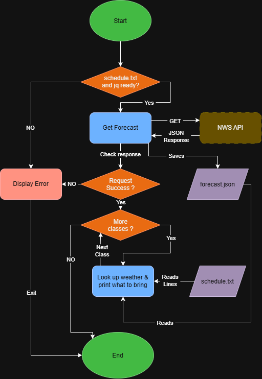

# jacketcheck

A Bash script that tells you what to wear based on the weather when you walk to and from your classes.

## The Problem

Weather at Purdue changes a lot during the day. This tool checks the forecast for when each class starts and ends so I know what to bring before I leave.

## How It Works

- Read my class schedule from `schedule.txt`
- Get the hourly forecast from the National Weather Service API
- Check the weather when each class starts and ends
- Recommend a jacket, umbrella, or light clothes



## Tech Stack

- Bash
- curl, jq, date
- National Weather Service API
- Data: `schedule.txt`, `forecast.json`

## Setup

1. Install jq: `winget install jqlang.jq` (Windows), `brew install jq` (macOS), or `sudo apt install jq` (Linux)
2. Run:
   ```bash
   git clone https://github.com/yuvraj-del/jacketcheck
   cd jacketcheck
   bash jacketcheck.sh
   ```
3. Edit `schedule.txt` with one class per line as `DAYS,CLASS,START,END` (days are M T W R F, 24-hour times).

Example input:
```
MWF,CS18000,16:30,17:20
```

Example output:
```
CLASS        START  END    TEMP   RAIN   CONDITIONS                               BRING
CS18000      16:30  17:20  41F    18%    Slight Chance Light Rain (walk back)     jacket
```

## Roadmap

- [x] Read schedule and fetch forecast
- [x] Check weather at class start and end
- [x] Recommend what to bring
- [x] Error handling (missing file, no jq, no internet, bad lines)
- [x] Show only classes that meet today
- [ ] Morning cron job
- [ ] `--tomorrow` flag

## Demo

[Video walkthrough](https://youtu.be/4VNcy_VWJKs)